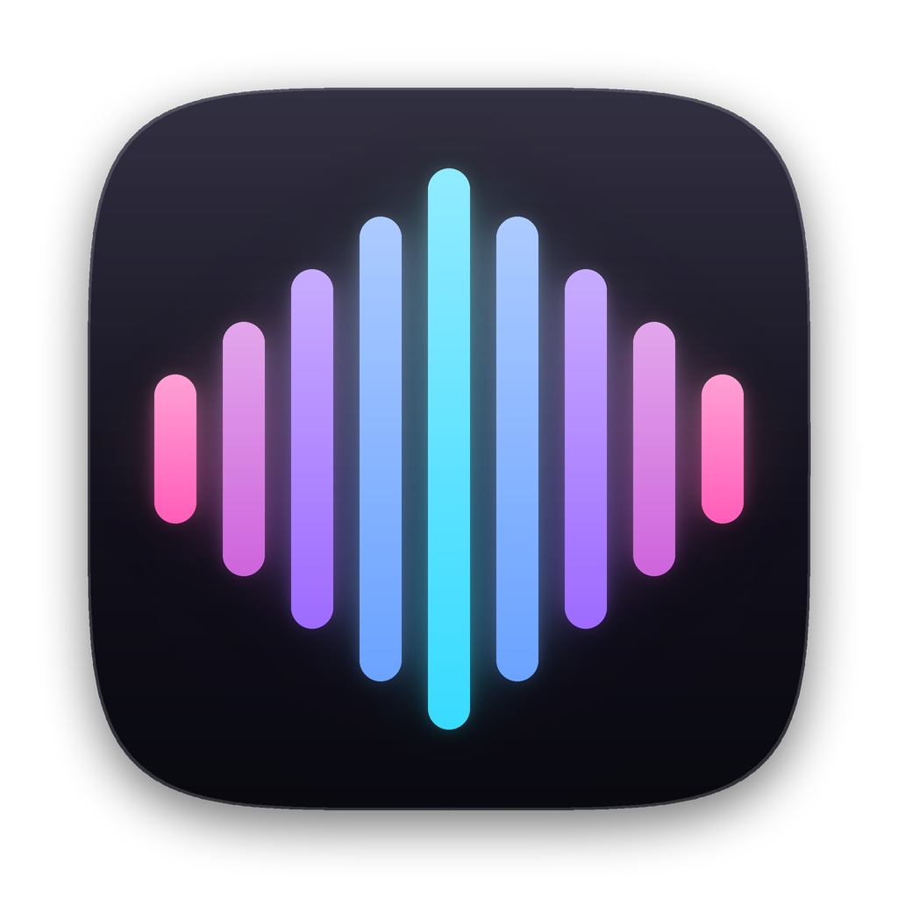
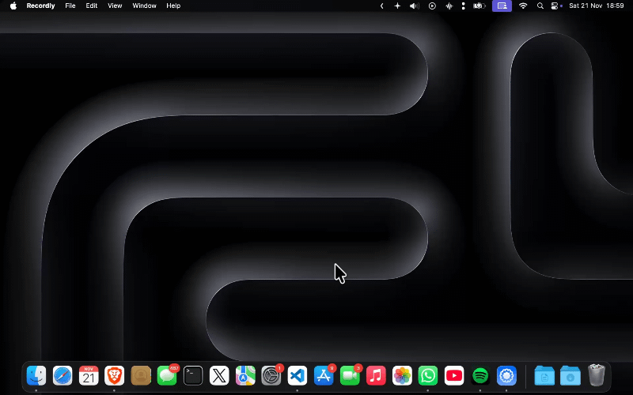

<h1 align="center">
  <br>
  <!-- Add your logo here, for example: -->
  <a href="https://github.com/<your-username>/NotchGlow"></a>
  <br>
  NotchGlow
  <br>
</h1>

<p align="center">
  <strong>Native macOS menu bar &amp; MacBook notch visualizer that reacts to music, system audio, microphone, and typing.</strong>
</p>

<p align="center">
  
  
  
  
</p>

**NotchGlow** brings your Mac's menu bar and MacBook notch to life with a lightweight, customizable overlay visualizer that dances to your **music**, **system sound**, **microphone**, and **typing**. Choose from 10 real-time animation styles, fine-tune every dimension, color, and glow, and enjoy 0% idle CPU usage—rendering only while something is actively moving.

<p align="center">
  
</p>

---

## ✨ Features

- 🎧 **Reacts to your music.** Follows whatever your Mac plays (Apple Music, Spotify, YouTube, videos…) with beat detection and a live frequency spectrum: bass in the middle, treble toward the edges.
- ⌨️ **Reacts to your typing.** Every keystroke triggers a ripple from the center. Type fast and it gets more energetic.
- 🎙️ **Reacts to the room.** Optionally listens to the microphone, too.
- 🎨 **10 animation styles.** Spike Wave, Audio Wave, Helix Wave, Equalizer, LED Meter, Heartbeat, Lightning, Particle Burst, Energy Pulse and Minimal Glow.
- 🌈 **Color palettes.** Aurora, Ember, Lagoon, Orchid, Mono and Lime, or design your own gradient.
- 🎚️ **Make it yours.** Size, glow, blur, opacity, speed, intensity, symmetry, timing and more, all with a live preview.
- 🖥️ **Multi-monitor ready.** Show it on every display, only the ones you choose, or wherever your mouse is.
- 🪟 **Full-screen aware.** Keep it over full-screen apps, or hide it there.
- 📌 **Above or beneath the menu bar.** Draw on top of the menu bar's blur, or behind it.
- 🔒 **Private by design.** It never knows *which* keys you press, never records audio, and never connects to the internet.
- 🪶 **Featherweight.** Renders only while something is moving.

---

## Download & Install

**Requires macOS 13 Ventura or later.** Works on Apple Silicon and Intel Macs.

1. Download the latest **NotchGlow `.dmg`** from the [Releases](../../releases/latest) page.
2. Open it and drag **NotchGlow** onto the **Applications** shortcut.
3. Open NotchGlow from your Applications folder. A waveform icon appears in your menu bar.

<details>
<summary><b>macOS says "NotchGlow can't be opened because it is from an unidentified developer"</b></summary>

<br>

This appears for apps that aren't signed with an Apple Developer ID, and only the first time you open the app. Either:

**Use Terminal (always works):**

```bash
xattr -dr com.apple.quarantine "/Applications/NotchGlow.app"
```

**…or use System Settings:** try to open the app, click **OK**, then go to **System Settings → Privacy & Security**, scroll down and click **Open Anyway** next to the NotchGlow message.

</details>

---

## Getting Started

1. **Click the menu bar icon.** A small panel opens where you can switch animation styles, pick a color palette, choose what NotchGlow reacts to, and decide whether it sits above or beneath the menu bar.
2. **Press play on some music, or just start typing.** NotchGlow asks for the permissions it needs the first time you use each feature. A short welcome screen walks you through it.
3. **Open Customize…** from the panel for the full settings. Everything you change is previewed live and saved automatically.

**Tip:** right-click the menu bar icon for a quick menu to turn NotchGlow on or off, open Customize, or quit.

---

## Customize Everything

| Section | What you can change |
|---|---|
| **General** | Turn NotchGlow on or off, pause all detection, the center gap and connected sides, which displays to use, full-screen behavior, layer, notch avoidance, vertical position, launch at login |
| **Animation Styles** | Pick one of the 10 styles |
| **Appearance** | Color palettes and custom gradients, opacity, glow, blur, corner radius, line thickness, element counts, speed, intensity |
| **Dimensions** | Overall width and height, how far each side expands |
| **Behavior** | How long the effect lingers and fades, sensitivity, typing intensity, frequency, symmetry, randomness, idle animation |
| **Sound & Music** | Choose to react to typing, music and system sound, the microphone, or any combination |

### Choose your displays

Under **General → Display** pick where NotchGlow appears:

- **All displays**
- **Selected displays**: tick the monitors you want. Your choice is remembered even if a monitor is unplugged and plugged back in.
- **Display under the mouse**: follows your cursor from screen to screen.

Switch off **Show over full-screen apps** and NotchGlow steps aside whenever an app, video or game goes full screen.

---

## Permissions & Privacy

macOS keeps keyboard input, system sound and the microphone private, so it asks before any app can use them. NotchGlow only asks for what the features you turn on need.

| To react to… | macOS permission |
|---|---|
| Typing in other apps | **Input Monitoring** or **Accessibility** (either one) |
| Music and system sound (macOS 14.4 and later) | **System Audio Recording**, audio only, no access to your screen |
| Music and system sound (macOS 13 – 14.3) | **Screen & System Audio Recording** |
| Sound around you | **Microphone** |

You can review or change these any time in **System Settings → Privacy & Security**.

**Your privacy comes first:**

- NotchGlow only notices *that* a key was pressed, never *which* key. It reads no characters and keeps no log.
- Sound is analyzed live in memory to measure loudness and frequencies, then thrown away. Nothing is recorded or saved.
- NotchGlow makes **no network connections** and has no accounts or analytics.

---

## FAQ

<details>
<summary><b>Does it work on a Mac without a notch?</b></summary>
<br>
Yes. The effect is centered on your menu bar on every Mac. On notched MacBooks you can keep the camera area clear or let the effect flow right through it.
</details>

<details>
<summary><b>Will it slow down my Mac or drain the battery?</b></summary>
<br>
No. NotchGlow only draws while something is actually animating, and uses essentially no CPU when idle.
</details>

<details>
<summary><b>Does it record what I type or what I listen to?</b></summary>
<br>
No. It cannot see which keys you press, and audio is measured live and immediately discarded. It never connects to the internet.
</details>

<details>
<summary><b>Why does it need Input Monitoring or Accessibility?</b></summary>
<br>
macOS requires one of these before any app can notice key presses in other apps. NotchGlow uses it only to know that a key was pressed, so it can animate.
</details>

<details>
<summary><b>It stopped reacting after I installed an update.</b></summary>
<br>
macOS can reset an app's permissions when it is replaced by a new copy. Open <b>System Settings → Privacy & Security</b>, switch NotchGlow back on under the relevant permission, then use <b>Relaunch App</b> in NotchGlow's Permissions or Sound &amp; Music pane.
</details>

<details>
<summary><b>The effect isn't reacting to my music.</b></summary>
<br>
Open <b>Customize… → Sound &amp; Music</b>, make sure <b>Laptop music &amp; system sound</b> is on, and allow the permission when macOS asks. Then relaunch NotchGlow once.
</details>

<details>
<summary><b>I use several monitors. Can I choose where it shows?</b></summary>
<br>
Yes. In <b>General → Display</b> choose <b>Selected displays</b> and tick the monitors you want.
</details>

<details>
<summary><b>How do I start it at login?</b></summary>
<br>
<b>Customize… → General → Startup → Launch at login.</b>
</details>

<details>
<summary><b>How do I quit or uninstall it?</b></summary>
<br>
Right-click the menu bar icon and choose <b>Quit NotchGlow</b>. To uninstall, drag NotchGlow from Applications to the Trash. To also remove its settings, run <code>defaults delete com.notchglow.app</code> in Terminal.
</details>

---

## 📋 Roadmap

- [x] Typing, music, system-sound and microphone reactions
- [x] 10 animation styles and 6 color palettes
- [x] Multi-display selection and full-screen control
- [x] Above / beneath the menu bar
- [ ] Notarized release and Homebrew install
- [ ] Floating "island" mode
- [ ] Style presets and settings import / export
- [ ] More animation styles

---

## Feedback & Support

Found a bug or have an idea? Please [open an issue](../../issues). When reporting a problem, include your macOS version and which reaction (typing, music, microphone) was involved.

<!-- Add your own links here, for example:
- Website: https://your-domain.com
- Support: support@your-domain.com
-->


## For Developers

Building from source, creating a DMG, signing and notarizing: see [BUILDING.md](BUILDING.md).

---

<p align="center">Keep your Mac glowing. ✨</p>
